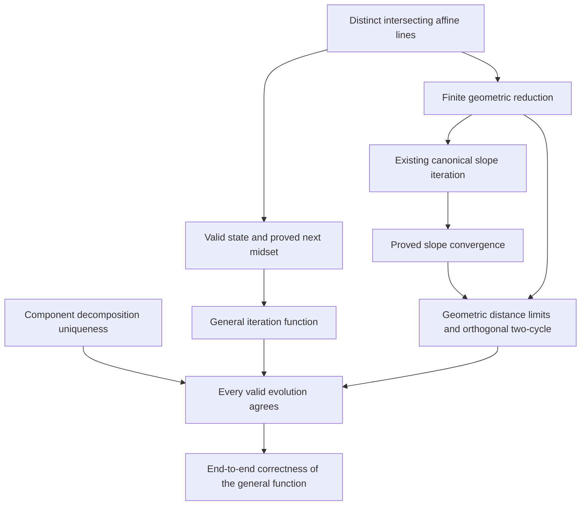

# End-to-end function correctness

The entry point is `Dynamics.intersecting_affine_lines_end_to_end`, backed by
`Dynamics.evolution_end_to_end`. Both are imported by `FitzhughFarnsworth.lean`.

## Inputs and functions

Two implicit affine equations `a*x + b*y = c` and `d*x + e*y = f` must describe
nondegenerate, distinct lines with a common point `v`. `affineState` packages
these inputs and hypotheses into `State v`. Vertical lines are included.

Points live in mathlib's standard `WithLp 1 (ℝ × ℝ)`. The local name `Point`
is an abbreviation; `Point.mk x y` and the `.x`/`.y` accessors retain Cartesian
notation. There is no separately constructed metric instance.

`next` selects a pair of distinct lines whose union is exactly the current
pair's metric midset. `next_spec` proves this equality from the general geometric
reduction theorem. `iterate` applies `next` recursively, and `evolution` exposes
the resulting sequence of line pairs.

This is a noncomputable mathematical function over real sets. It does not claim
to be an executable floating-point algorithm. Its use of classical choice does
not hide a correctness assumption: next-state existence is proved, and component
uniqueness makes the underlying geometric evolution independent of that choice.

## What is proved

1. The initial state is the supplied pair of affine lines.
2. Every state consists of two distinct genuine lines through the same point.
3. Every transition is the actual equidistance set of the preceding two lines,
   expressed as the union of the next two lines.
4. Every actual evolution reaches Configuration 1 or 2 within two steps.
5. The general function agrees with the existing slope recurrence in its
   canonical domain, at both even and odd indices.
6. Every genuine evolution from the same initial union produces exactly the
   same geometric union at every index, even if components are swapped freely.
7. Every genuine evolution converges along its parity subsequences to a distinct
   pair of orthogonal line pairs, with actual midset steps in both directions.
8. The two limiting pairs are related by Euclidean rotation through π/4 about
   the original intersection.

Convergence is stated directly using `Metric.infDist`: for every fixed point
`x`, its distance to the even-indexed unions converges to its distance to one
limiting union, and the odd-indexed distances converge to the other. The internal
profile is proved equal to that actual distance, rather than used as an
unconnected proxy. This avoids asserting global Hausdorff convergence for
unbounded line sets or convergence of arbitrary component labels.

## Proof chain

The proof first constructs one complete evolution using reduction and the
canonical results. It then proves equality of every competing valid evolution's
carriers, so the convergence theorem applies universally, including to the
separately defined `next`/`iterate` function. Neither construction nor transfer
assumes the existence of a limit.

## Useful declarations

| Declaration | Purpose |
| --- | --- |
| `Dynamics.next_spec` | Exact one-step geometric correctness |
| `Dynamics.iterate_add`, `Dynamics.evolution_add` | Restarting at an iterate gives the corresponding tail |
| `Dynamics.evolution_isEvolution` | Validity and correct steps at every index |
| `Dynamics.IsEvolution.valid`, `Dynamics.IsEvolution.step` | Named projections of those guarantees |
| `Dynamics.LinePair.carrier_decomposition` | Components are unique up to exchange |
| `Dynamics.IsEvolution.carrier_eq` | Choice/order independence for the whole sequence |
| `Dynamics.evolution_agrees_with_canonical` | Connection to the original algorithm |
| `Dynamics.evolution_reaches_attractor_within_two` | Reduction bound for the actual function |
| `Dynamics.every_evolution_converges` | Convergence for every valid geometric iteration |
| `Dynamics.TwoCycleAt.rotate` | Exact π/4 rotation around the intersection |
| `Dynamics.ConvergesToCycle.infDist_even`, `Dynamics.ConvergesToCycle.infDist_odd` | Separate metric-distance limits, with only the relevant limit's validity hypothesis |
| `Dynamics.IsEvolution.exists_geometric_limit`, `Dynamics.evolution_geometric_limit` | Geometric cycle and distance limits without unpacking the combined specification |
| `Dynamics.evolution_end_to_end` | Combined specification of the actual function |
| `Dynamics.intersecting_affine_lines_end_to_end` | Affine-coordinate input wrapper |

The build rejects unfinished proofs, and `scripts/Audit.lean` checks all project
declarations by their defining module against the standard Lean axiom allowlist,
including generic lemmas declared in `Metric`, `Isometry`, and `IsometryEquiv`.
